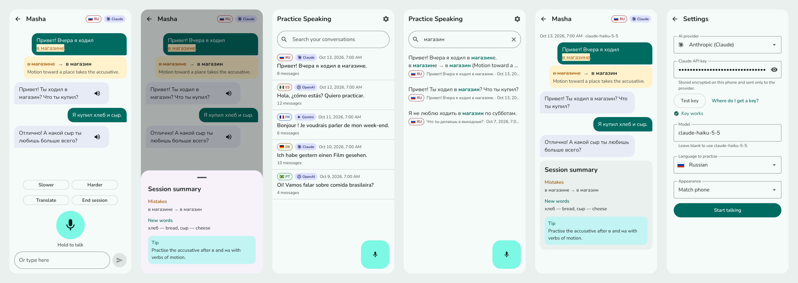
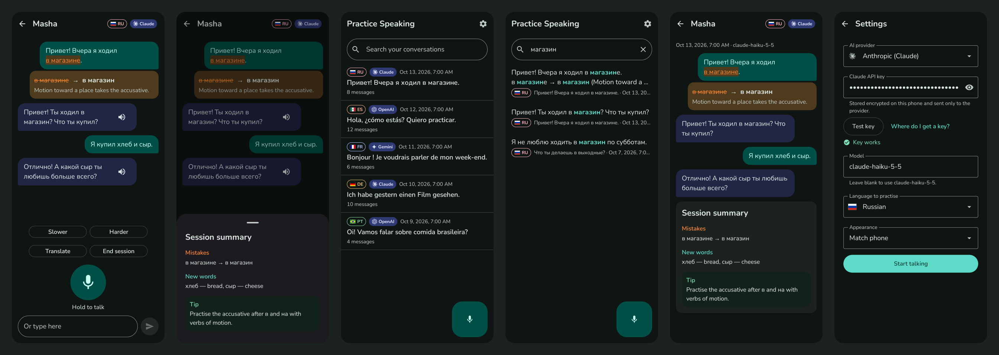
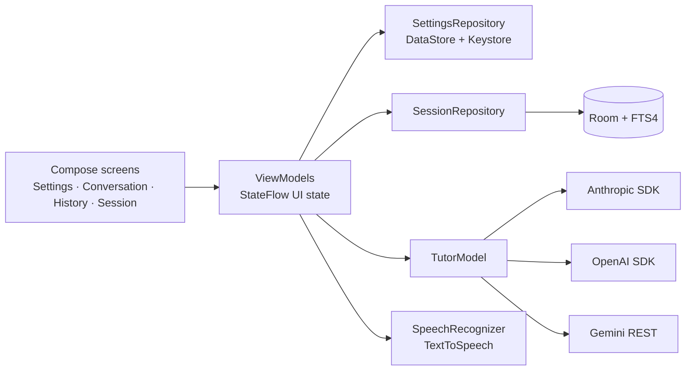

# Practice Speaking

[](https://github.com/winstonhoyle/practice-speaking/actions/workflows/ci.yml)

An Android app for practising a foreign language out loud. You hold the mic and talk, an AI tutor answers in one to three short sentences, and the phone reads the answer aloud. When you make a grammar mistake, the tutor's correction shows up under your message with the wrong phrase underlined. Every session is saved on the phone and can be searched later.

It supports Russian, French, Portuguese (Brazil), German, and Spanish (Mexico). You bring your own API key from Anthropic, OpenAI, or Google Gemini.

The latest signed APK is on the [Releases page](https://github.com/winstonhoyle/practice-speaking/releases/latest).



<details>
<summary>Dark theme</summary>



</details>

## What it does

- Speech in and speech out use Android's built-in `SpeechRecognizer` and `TextToSpeech`, in the language you're practising. A text box covers the times you can't talk.
- Each language has its own tutor: Masha (Russian), Camille (French), Ana (Portuguese), Lena (German), and Lucía (Spanish). They share one prompt template, with grammar priorities set per language.
- Corrections appear under your message (~~в магазине~~ → **в магазин**) and are never read aloud.
- Slower, Harder, and Translate buttons adjust the tutor mid-conversation. End session gives you a summary of your mistakes, new words, and one thing to practise next.
- History lists past sessions, and full-text search covers every message and correction ("магазин" also finds "магазине").

## Your API key stays on your phone

Keys are typed into Settings, encrypted with AES-GCM using a key held in the Android Keystore, and sent only to the provider you picked. There's no backend, no account, and no analytics. Keys from the developer's `.env` file are used by tests only and are never compiled into the app.

## Architecture



Only the `ai/` package knows which vendors exist. The ViewModels, the database, the prompt, and the response parser all work with the `TutorModel` interface and plain strings.

Three rules keep requests cheap and correct:

- History is append-only. Each tutor reply is saved with the provider's raw response and replayed exactly on the next turn, including reasoning blocks and their signatures. Nothing gets trimmed or rewritten, so prompt caching keeps working. After 60 turns the app suggests starting a fresh session instead.
- The system prompt is byte-identical for a given language (no dates, no IDs), so every provider can cache it.
- Models drift from the output format, so the parser accepts `->` as well as `→`, stray markdown, and summaries written as lists. If a block is malformed, the app shows the text as it came.

### Add a provider

1. Add an entry to `Provider` in `ai/Provider.kt`: display name, badge name, default model, key hint, the page where people create a key, and a one-color logo drawable. Settings, the badges, and the key link read from it.
2. Write a `TutorModel` class in `ai/`. Wrap each call in `providerCall` (from `ProviderSupport.kt`) so its exceptions become `TutorError`s, return the reply text with the raw response as `providerPayload`, and replay that payload on the next turn. Add its branch to `TutorModelFactory`. `listModels()` reads the provider's model list for the Settings picker.
3. Subclass `TutorModelContractTest` with the provider's mock responses: a reply, a refusal, an error, a context-length error, the key check, and a model list. The shared suite checks error mapping, refusals, history replay, `testKey()`, and `listModels()` against MockWebServer.

Nothing outside `ai/` changes.

### Errors

Every failure the learner can see is an `AppError` with a stable code. `ui/Errors.kt` maps each one to a message and one action, and the sealed types make that mapping exhaustive, so a new error doesn't compile until it has a message. Unexpected failures also show their code, so a bug report names the exact case.

| Code | What the learner sees | Action |
|---|---|---|
| `TUTOR_INVALID_KEY` | Check your API key | Open Settings |
| `TUTOR_MODEL_NOT_FOUND` | That model isn't available with this key. | Open Settings |
| `TUTOR_RATE_LIMITED` | Too many requests. Wait a moment, then retry. | Retry |
| `TUTOR_PROVIDER_DOWN` | The AI service isn't responding right now. | Retry |
| `TUTOR_OFFLINE` | No connection. Check your internet and retry. | Retry |
| `TUTOR_REFUSED` | The tutor wouldn't answer that one. | OK |
| `TUTOR_CONTEXT_TOO_LONG` | This conversation is too long for the model. | End session |
| `TUTOR_EMPTY_REPLY` | The tutor sent an empty reply. | Retry |
| `TUTOR_UNKNOWN` | Something went wrong, with the code and detail | Retry |
| `SPEECH_NOTHING_HEARD` | Didn't catch that. | OK |
| `SPEECH_NO_PERMISSION` | Allow the microphone, or type instead. | App settings |
| `SPEECH_LANGUAGE_UNAVAILABLE` | Speech recognition for this language isn't installed. | OK |
| `SPEECH_SERVICE_UNAVAILABLE` | Speech recognition needs a connection right now. | OK |
| `SPEECH_BUSY` | The microphone is busy. | OK |
| `SPEECH_VOICE_MISSING` | No voice is installed for this language. | Install voice |
| `SPEECH_FAILED_<n>` | Speech recognition failed, with Android's error number | OK |
| `STORAGE_KEY_UNREADABLE` | Your saved key can't be read on this phone anymore. | Open Settings |
| `STORAGE_DATABASE_FAILED` | Couldn't read or save your conversations. | OK |

## Tech stack

| | |
|---|---|
| Language and UI | Kotlin, Jetpack Compose, Material 3 |
| Architecture | Single activity, MVVM with `StateFlow`, Navigation Compose, manual DI (`AppContainer`) |
| AI providers | `anthropic-java`, `openai-java` (Responses API), Gemini `generateContent` over OkHttp + Jackson |
| Storage | Room with an FTS4 table, DataStore Preferences, Android Keystore |
| Speech | `SpeechRecognizer`, `TextToSpeech` (on-device, free) |
| Tests | JUnit, Robolectric, Compose UI tests, MockWebServer, coroutines-test |
| Build | Gradle 8.14.3, AGP 8.13.2, compileSdk 36, minSdk 26 |

The UI is built from one component library in `ui/components/`, and feature screens only arrange those components. [docs/DESIGN.md](docs/DESIGN.md) covers the tokens, the components, the writing rules, and the color-blind palette.

## Build and run

You need JDK 21 and the Android SDK (platform 36, build-tools 36.0.0).

```sh
./gradlew assembleDebug
adb install -r app/build/outputs/apk/debug/app-debug.apk
```

Or open the folder in Android Studio and press Run. On first launch the app opens Settings: pick a provider, paste a key, tap **Test key**, and choose a language. Key pages: [Anthropic](https://platform.claude.com/settings/keys), [OpenAI](https://platform.openai.com/api-keys), [Google AI Studio](https://aistudio.google.com/apikey).

On an emulator, use a Google Play system image so speech recognition and Google TTS are available. To talk to the app, turn on host audio input under Extended controls → Microphone, and install TTS voice data for the languages you'll practise.

## Tests

```sh
./gradlew testDebugUnitTest            # everything that runs offline
./gradlew spotlessApply                # format the code (ktlint)
./gradlew spotlessCheck detekt lint testDebugUnitTest assembleDebug   # what CI runs
```

The offline suite covers the response parser, the prompt renderer (the Russian render must match the original prompt byte for byte), Room and full-text search, settings storage, the error table, and the Conversation and Settings ViewModels with a scripted fake tutor. Every provider runs the same `TutorModelContractTest` against MockWebServer: error mapping, refusals, context-length errors, history replay, the key check, and the model list.

Live tests make real API calls, so they only run when asked. Put a key in a `.env` file at the repo root (it's gitignored) and pass `-Plive`:

```sh
echo 'ANTHROPIC_API_KEY=sk-ant-...' > .env
./gradlew testDebugUnitTest -Plive
```

A provider without a key in `.env` is skipped, so a missing key never fails the run.

### Pre-commit hooks

[pre-commit](https://pre-commit.com) runs the checks in `.pre-commit-config.yaml` on every commit: file hygiene (line endings, trailing whitespace, YAML and XML syntax, files over 1 MB), Spotless and detekt on Kotlin changes, and two guards that stop a commit containing an API key or a local file such as `.env`, `local.properties`, `keystore.properties`, or a keystore. Set it up once per clone:

```sh
pip install pre-commit      # or: pipx install pre-commit
pre-commit install
pre-commit run --all-files  # optional: check everything now
```

When Spotless reformats a file, the commit stops so you can review the change and stage it again. To skip the Gradle hooks for one commit, use `SKIP=spotless,detekt git commit`. CI runs the same hooks on every push.

## Releases

Signed APKs are attached to [GitHub Releases](https://github.com/winstonhoyle/practice-speaking/releases). Pushing a tag such as `v1.0.0` runs `.github/workflows/release.yml`, which runs the checks and tests, builds the release APK with version `1.0.0`, and attaches it to a new release.

The signing key stays out of the repo. To set it up once:

```sh
keytool -genkeypair -v -keystore ~/keys/practice-speaking.jks -alias practice-speaking \
  -keyalg RSA -keysize 4096 -validity 10000
base64 -w0 ~/keys/practice-speaking.jks   # paste into the RELEASE_KEYSTORE_BASE64 secret
```

In the repo's Actions secrets, add `RELEASE_KEYSTORE_BASE64`, `RELEASE_STORE_PASSWORD`, `RELEASE_KEY_ALIAS`, and `RELEASE_KEY_PASSWORD`. For signed local builds, create a gitignored `keystore.properties` at the repo root:

```properties
RELEASE_STORE_FILE=/home/you/keys/practice-speaking.jks
RELEASE_STORE_PASSWORD=...
RELEASE_KEY_ALIAS=practice-speaking
RELEASE_KEY_PASSWORD=...
```

Without that file, `assembleRelease` signs with the debug key so the build can still be installed and tested.

Keep a backup of the keystore and its passwords. An app signed with a lost key can't be updated in place.

## License

MIT, see [LICENSE](LICENSE). The bundled Nunito font is under the [SIL Open Font License](docs/licenses/Nunito-OFL.txt), and the Material icons are Apache 2.0. The app icon's letters are Nunito outlines. Flags come from flag-icons (MIT). The provider logos come from Simple Icons and belong to their owners; see [docs/licenses/TRADEMARKS.md](docs/licenses/TRADEMARKS.md).
