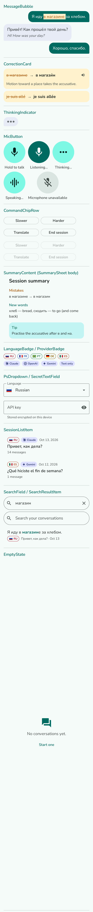
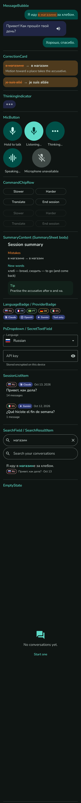
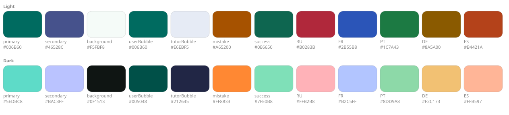

# Design system

Practice Speaking is built from one small component library. Feature screens only arrange components; they never style anything themselves. For where the screen and component code lives, see the [ui/ README](../app/src/main/java/io/winstonhoyle/practicespeaking/ui/README.md).

The mood is calm and uncluttered, closer to a conversation than a classroom. Each screen has one clear action, usually the mic.

| Light | Dark |
|---|---|
|  |  |

The images are rendered on the JVM from the debug-only `ComponentGalleryScreen`. To regenerate them after changing a token or component:

```sh
./gradlew testDebugUnitTest -Pscreenshots --tests '*GalleryScreenshotTest*'
```

On a device, debug builds install a second launcher entry, **PS Components**, which opens the same gallery with a light/dark toggle.

## The one rule

**No hardcoded `Color(...)`, `.dp`, or `.sp` outside `ui/theme/` and `ui/components/`.** Feature code reads tokens (`PsTheme.colors`, `PsTheme.spacing`, …) and uses components. Check before review:

```sh
grep -rnE 'Color\(0x|[0-9]\.dp|[0-9]\.sp' app/src/main/java --include=*.kt | grep -v '/ui/theme/\|/ui/components/'
```

The command should print nothing.

## Tokens (`ui/theme/`)

Material 3 with a fixed brand scheme (dynamic color off), so the app and its screenshots look the same on every device. Light and dark get equal care.

### Color



`palette.svg` is generated from the actual token values by the same screenshot test, so it can't drift from `Color.kt`.

| Token | Role |
|---|---|
| `primary` | Deep teal brand color: mic, primary actions, search matches |
| `secondary` | Indigo: provider badge |
| `userBubble` / `tutorBubble` | The two speakers, clearly different |
| `mistake` / `mistakeContainer` | Amber: underlined mistakes, struck-through text in correction cards |
| `success` / `successContainer` | Teal-green: "Test key" ✓, summary tip |
| Language accents (RU FR PT DE ES) | Badges only; never in place of a semantic color |

Material roles live in `PsLightColorScheme` / `PsDarkColorScheme`. The extra roles live in `PsExtendedColors`, provided through a `CompositionLocal`.

Read [Color and access](#color-and-access) before changing a color.

### Typography

**Nunito**, a single variable font in `res/font/nunito.ttf` that covers Latin Extended and Cyrillic, so all five languages render in one family. Its license (SIL OFL 1.1) is in [`licenses/Nunito-OFL.txt`](licenses/Nunito-OFL.txt).

| Style | Size / line | Weight | Used for |
|---|---|---|---|
| `titleLarge` | 22 / 28 | Bold | Top bar, sheet titles |
| `titleMedium` | 18 / 24 | SemiBold | Session titles |
| `titleSmall` | 16 / 22 | SemiBold | Summary section headings |
| `bodyLarge` | 18 / 26 | Regular | Chat messages, corrections |
| `bodyMedium` | 16 / 24 | Regular | Body text (minimum) |
| `bodySmall` | 14 / 20 | Regular | Dates, counts |
| `labelLarge` | 16 / 20 | SemiBold | Buttons, mic label |
| `labelSmall` | 12 / 16 | Bold | Badges |

Sizes are `sp`, so they follow the system font scale. Every component has a 1.5× font-scale preview.

### Shape

| Token | Value |
|---|---|
| `bubbleUser` | 20dp, tight 4dp tail at bottom-end |
| `bubbleTutor` | 20dp, tight 4dp tail at bottom-start |
| `card` | 16dp |
| `chip` | Fully rounded |

### Spacing and sizes

`PsSpacing`: `xs 4 · sm 8 · md 12 · lg 16 · xl 24 · xxl 32` (dp).
`PsSizes`: touch target 48, icon 24, small icon 18, badge icon 14, flag width 16 (height follows at 4:3), flag corner 2, mic button 96, bubble max width 320, dot 8, divider 1.

### Motion

Motion stays small. The mic pulses while listening, three dots pulse while the tutor thinks, and new messages fade and slide in. When the system "Remove animations" setting is on, `rememberReduceMotion()` turns every animation off.

### Icons

Material icons (Apache-2.0), bundled as vector drawables converted from SVG in `res/drawable/ic_*.xml` and exposed through `PsIcons`. There's no icon library dependency. To add an icon, convert its SVG to `res/drawable/ic_<name>.xml` and add one line to `PsIcons`.

Provider logos (`ic_logo_*.xml`) come from Simple Icons and are drawn in one color, tinted like any other icon. Each `Provider` names its own logo, so the UI never picks one by vendor. Flags (`ic_flag_*.xml`) come from flag-icons and keep their real colors; every language is pinned to one country's variant, so Portuguese shows Brazil and Spanish shows Mexico. `FlagImage` draws them at 4:3 with a hairline edge so white stripes stay visible on a white surface. Sources and licenses are in [`licenses/TRADEMARKS.md`](licenses/TRADEMARKS.md).

The converter is `Svg2Vector` from the Android build tools (Android Studio's Vector Asset tool uses the same class). Android rejects units such as `1pt` in `strokeWidth`, so check a converted file builds before you commit it.

### App icon


The launcher icon is an adaptive vector: the brand teal (`Teal40`) behind a white speech bubble with ß, Л, and ñ cut out of it, one letter each from German, Russian, and Spanish. The letters are Nunito ExtraBold outlines, so they match the UI. The same drawable (`res/drawable/ic_launcher_foreground.xml`) is the monochrome layer for themed icons. `docs/images/logo.svg` uses the same path, and `ScreensScreenshotTest` renders `docs/images/social-preview.png` (1280 x 640) for the GitHub social preview.

## Components (`ui/components/`)

Each component is stateless (state in, events out), takes `modifier: Modifier = Modifier`, and has `@PreviewPsThemes` (light, dark, 1.5× font). Components take plain strings or the app's own types (`Provider`, `TutorLanguage`), never SDK types, so the UI stays vendor-agnostic.

| Component | Purpose |
|---|---|
| `PsTopBar` | Title, optional back button, optional actions |
| `MessageBubble` | User or tutor message; `highlights` underline mistakes; an optional translation shows inside, a step quieter |
| `ChatMessageItem` | One transcript message: the bubble, its correction card, and the hear-it, translate, and edit actions under it |
| `CorrectionCard` | ~~wrong~~ → **right** + short explanation, with an optional button that reads the correct form |
| `MicButton` | Hold-to-talk; `Idle / Listening / Thinking / Speaking / Disabled`; pulse; haptics |
| `ThinkingIndicator` | Three animated dots in a tutor bubble |
| `CommandChipRow` | Slower · Harder · Translate · End session |
| `SummarySheet` / `SummaryContent` | Mistakes, New words, Tip (sheet, or inline card in session detail) |
| `LanguageBadge` | Flag and language code, outlined in the language's accent color |
| `ProviderBadge` | Which AI provider a session used: logo and name, or the name alone |
| `FlagImage` / `ProviderLogo` | The flag or logo by itself, for pickers |
| `PsIconAction` | Icon-only button; `subtle` draws a small icon in the secondary color for actions beside content (48dp target either way) |
| `PsDropdown<T>` | Generic picker for provider, language, …, with an optional icon per option |
| `PsTextField` | One-line field; with `suggestions` it also offers a filtered menu (the model list) |
| `SecretTextField` | Masked API-key field with show/hide |
| `SessionListItem` | History row: badges, title, date, message count |
| `SearchField` / `SearchResultItem` | Search input; hit with matches highlighted |
| `EmptyState` | Icon + message + optional action |
| `ErrorBanner` | Inline error + optional action (Retry, Open Settings, …) |

### Shared building blocks (`Primitives.kt`)

Components are built from a few internal primitives, so each layout decision is made once:

| Primitive | Used by |
|---|---|
| `PsPill` (text with an optional leading icon) | `LanguageBadge`, `ProviderBadge` |
| `BubbleSurface` | `MessageBubble`, `ThinkingIndicator` |
| `PsCard` | `CorrectionCard`, summary tip, `ErrorBanner` |
| `ListRow` + `MetaRow` + `SecondaryText` | `SessionListItem`, `SearchResultItem` |

When two components start to share a layout, move it into a primitive instead of copying it. The same goes for behavior: the translate button's logic lives once in `ui/Translations.kt` (`TranslationToggles`), and both the conversation and the saved-session screens use it.

## Accessibility (nice to have)

Color contrast and color blindness are covered under [Color and access](#color-and-access).

These are followed where they're cheap; they don't block a release.

- Touch targets ≥ 48dp; mic ≥ 96dp.
- Mistakes aren't shown by color alone: underline in the bubble, strikethrough + arrow in the card.
- Icon buttons have content descriptions; error banners are polite live regions.

## Writing

Every string a person reads follows these rules: UI text, KDoc and comments, the README, and these docs. They come from Wikipedia's [Signs of AI writing](https://en.wikipedia.org/wiki/Wikipedia:Signs_of_AI_writing), which the `humanizer` skill applies during reviews.

### UI text

- Say what happened and what to do next, in that order. "No connection. Check your internet and retry." The banner's button handles the action.
- Use the learner's words: "API key", "model", "session". Leave out HTTP codes and SDK names.
- Sentence case everywhere, including buttons ("Start talking", "Open Settings" keeps the screen's name).
- Keep it short enough to read while holding the mic. One sentence is usual; two is the limit.
- Vendor names appear in two places only: the provider picker and the provider badge. Everywhere else it's "the AI service" or "the tutor".
- Contractions are fine ("isn't", "wouldn't"). Escape the apostrophe in `strings.xml` (`isn\'t`).
- Strings live in `res/values/strings.xml`. A few exact phrases come from the spec and are tested, like "Check your API key" and "Long session. End it and start fresh?". Change those in the spec first.

### Docs, comments, and KDoc

- Plain verbs: "is", "has", "returns". Avoid "serves as", "leverages", "ensures".
- No em or en dashes in prose. Use a period, comma, colon, or parentheses. (The tutor prompt is the exception: it's model input and must match the original byte for byte.)
- No "not X but Y" framing, no closing line that restates the paragraph, no lists of three added for rhythm.
- No bold labels at the start of every bullet. Bold one term when the reader would otherwise miss it.
- A comment explains why, not what. If the code already says it, delete the comment.
- Describe the code as it is now, and leave the history of a change to its commit message.

### The tutor prompt

`app/src/main/assets/tutor_prompt_template.md` is written for a model. It follows its own rules: the CORRECTION and SUMMARY formats, the arrows, and the dashes are parsed or copied exactly. Don't run it through the humanizer, and keep `PromptRendererTest` green. The Russian render at level A2 is compared byte for byte with `app/src/test/resources/russian_tutor_system_prompt.md`; when the prompt changes on purpose, review the diff and update that file.

## Kotlin

- ktlint's official style, enforced by Spotless with the Compose rules. `./gradlew spotlessApply` formats; CI runs `spotlessCheck`. Settings live in `.editorconfig` (140-column lines, signatures wrap only when they don't fit).
- detekt runs on top of its defaults. Each change to the defaults in `config/detekt/detekt.yml` says why. A one-off exception is a `@Suppress` with a reason next to it.
- The pre-commit hooks (`.pre-commit-config.yaml`) run Spotless and detekt on each commit that touches Kotlin, so most problems surface before CI. See the README for setup.
- Use the `kotlin-lsp` plugin for navigation and quick diagnostics while editing. `./gradlew testDebugUnitTest assembleDebug` is the final word.
- Only `ai/` knows vendors exist. Everything else talks to `TutorModel`, `Provider`, and plain strings. A new vendor is one `TutorModel` class plus one `Provider` entry.
- Failures cross layers as a `Result` holding an `AppException`, which carries an `AppError`. The UI maps each error to a message and one action in `ui/Errors.kt`.
- ViewModels expose one `StateFlow<…UiState>` and plain functions for events. Screens come in pairs: a `…Route` that wires the ViewModel and Android APIs, and a stateless `…Screen` that tests and previews can call directly.
- Composables are stateless where possible: state in, events out, `modifier: Modifier = Modifier` as the first optional parameter.
- Reuse before writing. Shared layout goes in `ui/components/Primitives.kt`; a second copy of a layout means it belongs there.
- Icons are Material SVGs converted to vector drawables (`res/drawable/ic_*.xml`) and exposed through `PsIcons`. No icon libraries.
- Name tests after behavior: `refusal_mapsToRefused`, `ftsFindsWordsInTextAndCorrection…`.

## Color and access

Both themes were measured against two targets:

1. WCAG contrast for every text and icon pair the UI uses: 4.5:1 for text, 3:1 for icons and large text.
2. Colors that carry meaning stay apart under simulated protanopia, deuteranopia, and tritanopia (ΔE ≥ 15 in CAM02-UCS). Mistake vs. success and learner vs. tutor bubble meet it.

A new color should meet both targets too. Language badges and the correction/tip card backgrounds don't always meet the second one. Five accents can't all stay apart for every type of color blindness, so every badge also shows its flag and code (RU, FR, PT, DE, ES), and the cards carry a strikethrough or a "Tip" heading.

Color is never the only signal anywhere in the app. A mistake is underlined in the bubble and struck through with an arrow in the card. Key status shows ✓ or ✗ next to its text.

The current pairs:

| Meaning | Light | Dark |
|---|---|---|
| Mistake (amber) | `#A65200` on `#FFF2CC` | `#FF8833` on `#4E3A1D` |
| Success (teal-green) | `#0E6650` on `#C2F4F4` | `#7FE0B8` on `#12211A` |

Red against green is the pairing most color-blind people can't separate, which is why mistakes are amber and success leans toward teal.
